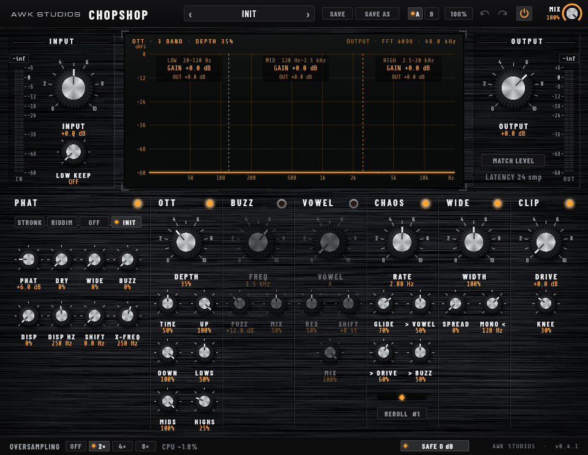

# CHOPSHOP

**Bass fattening rack: PHAT, OTT, BUZZ, VOWEL, CHAOS, WIDE and CLIP in one plugin.**



CHOPSHOP is a chain of bass-design modules in signal order. LOW KEEP sends the sub around the whole rack, so the low end stays clean and centred while the mids get chewed.

## Features

- **PHAT:** drive, colour, disperser and frequency shifter, with STRONK / RIDDIM starting points.
- **OTT:** three-band upward and downward compression on a live spectrum screen, with gain per band.
- **BUZZ, VOWEL** (A E I O U formants), **WIDE** and **CLIP**.
- **CHAOS:** a random LFO that can push PHAT drive, BUZZ frequency and VOWEL.
- **LOW KEEP:** everything below the set frequency skips the rack.
- Oversampling (OFF to 8x) for the whole chain, MATCH LEVEL, MIX and SAFE.
- 44 factory presets.

## Install

Windows 64-bit, VST3. Built and tested in FL Studio.

1. Download `ChopShop-v0.3.2-win64.zip` from [Releases](../../releases/latest).
2. Copy `ChopShop.vst3` into `C:\Program Files\Common Files\VST3\`.
3. Copy the files in `presets` into `Documents\Awknode\Presets\ChopShop\` (create the folder if it doesn't exist).
4. Rescan plugins in your DAW.

## Using it

Every awk studios plugin has the same top strip: preset browser, A/B, undo/redo, power (bypass) and a global MIX. Knobs drag up and down (hold Ctrl or Shift for fine control), scroll to nudge, and double-click to reset. **SAFE** in the footer is an output limiter that keeps the plugin from going over 0 dBFS; it's on by default.

The full control reference is in the **[manual](docs/MANUAL.md)**.

## Build from source

You'll need Docker. Clone this repo next to the [nice-plug-awk](https://github.com/awknode/nice-plug-awk) framework fork, then run the build script:

```sh
git clone https://github.com/awknode/chopshop
git clone -b awk-studios https://github.com/awknode/nice-plug-awk
cd chopshop && ./build.sh
```

The plugin lands in `target/bundled/ChopShop.vst3`.

## License

GPL-3.0. See [LICENSE](LICENSE). Built with [nice-plug](https://codeberg.org/RustAudio/nice-plug).

---

More awk studios plugins: [VISE](https://github.com/awknode/vise) · [SALVE](https://github.com/awknode/salve) · [HOIST](https://github.com/awknode/hoist) · [KILN](https://github.com/awknode/kiln) · [PATINA](https://github.com/awknode/patina) · [THROWBACK](https://github.com/awknode/throwback) · [THROW FX](https://github.com/awknode/throw-fx) · [KICKNULL](https://github.com/awknode/kicknull) · [ALLEYVERB](https://github.com/awknode/alleyverb) · [WAVETAG](https://github.com/awknode/wavetag) · [dBCOMP](https://github.com/awknode/dbcomp) · [dBVOX](https://github.com/awknode/dbvox)
